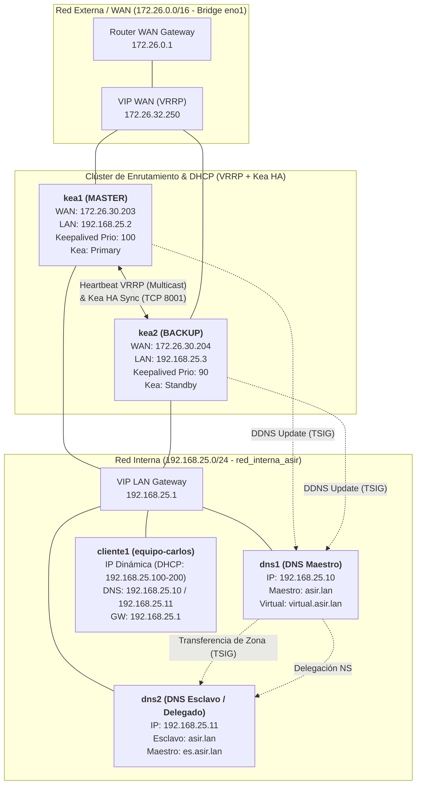

# Infraestructura de Alta Disponibilidad: Clúster Kea DHCPv4 + BIND9 (DDNS y Delegación)


Laboratorio de infraestructura de red completamente automatizado mediante **Vagrant** y **VirtualBox** sobre máquinas virtuales **Debian 12 (Bookworm)**. 

Implementa enrutamiento redundante con VRRP (**Keepalived**), asignación dinámica de direcciones en alta disponibilidad (**Kea DHCPv4 Hot-Standby**), actualizaciones dinámicas seguras de DNS (**DDNS** con firmas TSIG) y una jerarquía completa de nombres de dominio con servidores maestro, esclavo, subdominios virtuales y delegación de zonas (**BIND9**).

---

## 📑 Tabla de Contenidos

1. [Topología y Arquitectura de Red](#1-topología-y-arquitectura-de-red)
2. [Plan de Direccionamiento](#2-plan-de-direccionamiento)
3. [Explicación Detallada Paso a Paso](#3-explicación-detallada-paso-a-paso)
   - [Paso 1: Parámetros Globales y Seguridad Criptográfica (TSIG)](#paso-1-parámetros-globales-y-seguridad-criptográfica-tsig)
   - [Paso 2: Clúster de Enrutamiento y DHCP HA (kea1 y kea2)](#paso-2-clúster-de-enrutamiento-y-dhcp-ha-kea1-y-kea2)
   - [Paso 3: Servidor DNS Maestro (dns1)](#paso-3-servidor-dns-maestro-dns1)
   - [Paso 4: Servidor DNS Esclavo y Zona Delegada (dns2)](#paso-4-servidor-dns-esclavo-y-zona-delegada-dns2)
   - [Paso 5: Nodo Cliente de Pruebas (cliente1)](#paso-5-nodo-cliente-de-pruebas-cliente1)
4. [Jerarquía DNS y Zonas](#4-jerarquía-dns-y-zonas)
5. [Requisitos Previos y Configuración](#5-requisitos-previos-y-configuración)
6. [Puesta en Marcha y Verificación](#6-puesta-en-marcha-y-verificación)
7. [Pruebas de Resiliencia y Alta Disponibilidad](#7-pruebas-de-resiliencia-y-alta-disponibilidad)
8. [Estructura del Proyecto](#8-estructura-del-proyecto)

---

## 1. Topología y Arquitectura de Red



---

## 2. Plan de Direccionamiento

| Nodo (VM) | Nombre en VirtualBox | Rol en la Infraestructura | IP Red Interna (LAN) | IP Red Externa (WAN) | RAM / CPU |
| :--- | :--- | :--- | :--- | :--- | :--- |
| **VIP (VRRP)** | *N/A (Virtual)* | Puerta de enlace flotante y SNAT de salida | `192.168.25.1` | `172.26.32.250` | - |
| **kea1** | `ASIR_KEA1` | DHCPv4 Primario + DDNS + Keepalived `MASTER` + NAT | `192.168.25.2` | `172.26.30.203` | 1024 MB / 1 vCPU |
| **kea2** | `ASIR_KEA2` | DHCPv4 Standby + DDNS + Keepalived `BACKUP` + NAT | `192.168.25.3` | `172.26.30.204` | 1024 MB / 1 vCPU |
| **dns1** | `ASIR_DNS1` | BIND9 Maestro (`asir.lan` y `virtual.asir.lan`) | `192.168.25.10` | *Sin interfaz WAN* | 512 MB / 1 vCPU |
| **dns2** | `ASIR_DNS2` | BIND9 Esclavo (`asir.lan`) y Maestro (`es.asir.lan`) | `192.168.25.11` | *Sin interfaz WAN* | 512 MB / 1 vCPU |
| **cliente1** | `ASIR_CLIENTE1` | Cliente DHCP (`equipo-carlos`) con registro DDNS | Dinámica (`192.168.25.100-200`) | *Sin interfaz WAN* | 512 MB / 1 vCPU |
| *Reserva* | *N/A (Estática)* | Impresora de departamento (`08:00:27:aa:bb:cc`) | `192.168.25.50` | *Sin interfaz WAN* | - |

---

## 3. Explicación Detallada Paso a Paso

### Paso 1: Parámetros Globales y Seguridad Criptográfica (TSIG)
Al inicio del `Vagrantfile` se establecen los valores globales:
* **Claves TSIG (`HMAC-SHA256`)**:
  * `CLAVE_TRANSFERENCIA`: Autentica de extremo a extremo la transferencia de zonas entre `dns1` (maestro) y `dns2` (esclavo), evitando envenenamientos o accesos no autorizados.
  * `CLAVE_DDNS`: Permite al demonio `kea-dhcp-ddns` enviar actualizaciones dinámicas autenticadas a `dns1` cuando un cliente obtiene o libera una concesión.
* **`ADAPTADOR_PUENTE`**: Tarjeta física del anfitrión (`eno1`) utilizada para que `kea1` y `kea2` se conecten a la red del aula/exterior.

---

### Paso 2: Clúster de Enrutamiento y DHCP HA (`kea1` y `kea2`)
Ambos nodos ejecutan el aprovisionamiento `script_cluster_kea`, parametrizado con `MASTER` (prioridad 100) en `kea1` y `BACKUP` (prioridad 90) en `kea2`:

1. **Enrutamiento y SNAT (`sysctl` + `nftables`)**:
   * Habilita el reenvío de tráfico IPv4 (`net.ipv4.ip_forward=1`).
   * Configura una regla en `nftables` (cadena `postrouting`) que aplica Source NAT (`snat`) hacia la IP virtual WAN (`172.26.32.250`).
2. **Redundancia con Keepalived (VRRP v2)**:
   * Sincroniza en un grupo (`GRUPO_GATEWAY`) las instancias LAN y WAN. Si alguna interfaz física falla, todo el conjunto conmuta al nodo secundario.
   * Ambas interfaces de red en VirtualBox tienen configurado el modo promiscuo (`allow-all`) para permitir tráfico multicast VRRP y direcciones MAC compartidas.
3. **Servicio Kea DHCPv4 en Modo Hot-Standby**:
   * Utiliza el hook `libdhcp_ha.so` comunicándose a través de sockets HTTP en el puerto `8001/TCP`.
   * En condiciones normales, `kea1` atiende todas las peticiones DHCP y replica el estado de las concesiones a `kea2`. Si `kea1` no responde a los latidos (*heartbeat*), `kea2` toma el servicio sin pérdida de asignaciones.
4. **Actualizaciones Dinámicas DNS (`kea-dhcp-ddns`)**:
   * Al otorgar una concesión, genera peticiones DNS UPDATE hacia `dns1` (`192.168.25.10`) firmadas con `ddns-key`, creando registros tipo `A` en `asir.lan` y `PTR` en `25.168.192.in-addr.arpa`.
5. **Persistencia de Rutas (`ruta-wan.service`)**:
   * Un servicio `systemd` elimina en cada arranque la ruta por defecto creada por la interfaz NAT propia de Vagrant (`10.0.2.2`), garantizando que la salida a Internet fluya por la puerta de enlace externa real (`172.26.0.1`).

---

### Paso 3: Servidor DNS Maestro (`dns1`)
Aprovisionado mediante `script_dns_maestro` (`192.168.25.10`):

1. **Recursión y Reenvío**:
   * Acepta consultas de la red interna `192.168.25.0/24` y reenvía consultas externas a `1.1.1.1` y `9.9.9.9`.
2. **Zonas Maestras y Políticas de Actualización**:
   * Zonas `asir.lan` y `25.168.192.in-addr.arpa`.
   * Notificación automática de cambios a `dns2` mediante `also-notify`.
   * Política `update-policy { grant ddns-key zonesub ANY; };` para permitir altas/bajas automáticas desde Kea DHCP.
3. **Almacenamiento de Zonas**:
   * Ubicadas en `/var/lib/bind/` con permisos para el usuario del sistema `bind`, permitiendo la generación de ficheros `.jnl` (*journal*) tras recibir transacciones DDNS.

---

### Paso 4: Servidor DNS Esclavo y Zona Delegada (`dns2`)
Aprovisionado mediante `script_dns_esclavo` (`192.168.25.11`):

1. **Rol Esclavo (Secundario)**:
   * Réplica autoritativa de `asir.lan` y `25.168.192.in-addr.arpa` sincronizada mediante la clave `transfer-key`.
   * Si `dns1` deja de operar, `dns2` continúa atendiendo consultas de nombres en la red local.
2. **Rol Maestro Delegado (`es.asir.lan`)**:
   * `dns1` delega el subdominio mediante registros `NS` y *Glue Record* hacia `192.168.25.11`.
   * `dns2` tiene autoridad exclusiva sobre `es.asir.lan`, resolviendo registros como `www.es.asir.lan` (`192.168.25.70`) y `ftp.es.asir.lan` (`192.168.25.71`).

---

### Paso 5: Nodo Cliente de Pruebas (`cliente1`)
Aprovisionado mediante `script_nodo_cliente`:
* Nombre de host fijado a `equipo-carlos`.
* Interfaz configurada sin autoconfiguración de Vagrant (`auto_config: false`), forzando una petición DHCP real mediante `dhclient -v -H "equipo-carlos"`.
* El envío de la opción `Host Name` dispara el flujo DDNS completo.

---

## 4. Jerarquía DNS y Zonas

```
. (Raíz)
 └── lan
      └── asir.lan (Maestro: dns1 / Esclavo: dns2)
           ├── router           --> 192.168.25.1 (VIP)
           ├── kea1             --> 192.168.25.2
           ├── kea2             --> 192.168.25.3
           ├── dns1             --> 192.168.25.10
           ├── dns2             --> 192.168.25.11
           ├── impresora        --> 192.168.25.50 (Reserva DHCP)
           ├── equipo-carlos    --> Dinámico por DDNS
           │
           ├── virtual.asir.lan (Subdominio Virtual en dns1)
           │    └── www         --> 192.168.25.60
           │
           └── es.asir.lan (Subdominio Delegado a dns2)
                ├── nssub       --> 192.168.25.11 (NS + Glue)
                ├── www         --> 192.168.25.70
                └── ftp         --> 192.168.25.71
```

---

## 5. Requisitos Previos y Configuración

### Requisitos del Sistema Anfitrión
* **Vagrant**: $\ge$ 2.3.0
* **VirtualBox**: $\ge$ 7.0 (con Extension Pack recomendado)
* **Recursos Mínimos**: 4 GB de RAM libre y 4 núcleos de CPU
* **Sistema Operativo**: Linux / macOS / Windows con soporte de virtualización (VT-x / AMD-V) activado en BIOS/UEFI.

### Ajuste de Tarjeta de Red Puente (WAN)
Antes de desplegar, verifica el nombre de tu interfaz de red física conectada a Internet:
```bash
ip -o link show | awk -F': ' '{print $2}'
```
En el archivo `Vagrantfile` (línea 24), ajusta el valor de `ADAPTADOR_PUENTE` si tu interfaz difiere de `eno1`:
```ruby
ADAPTADOR_PUENTE = "tu_interfaz" # Ej: eth0, enp3s0, wlp2s0
```

---

## 6. Puesta en Marcha y Verificación

### 1. Iniciar el entorno
Despliega las 5 máquinas virtuales en orden:
```bash
vagrant up
```

Para verificar el estado de las máquinas:
```bash
vagrant status
```

### 2. Pruebas de Conectividad desde el Cliente
Conéctate por SSH al nodo cliente:
```bash
vagrant ssh cliente1
```

Ejecuta las comprobaciones de red:
```bash
# 1. Comprobar IP asignada por Kea DHCP (rango 192.168.25.100-200)
ip a show eth1

# 2. Comprobar puerta de enlace predeterminada (VIP: 192.168.25.1)
ip route show

# 3. Validar salida a Internet a través de la VIP y NAT
ping -c 3 1.1.1.1
```

### 3. Pruebas de Resolución DNS y DDNS
Desde el propio `cliente1`:
```bash
# Resolución directa del propio cliente generada por DDNS
dig @192.168.25.10 equipo-carlos.asir.lan +short

# Resolución inversa de la IP obtenida por DHCP
dig @192.168.25.10 -x $(hostname -I | awk '{print $2}') +short

# Transferencia/consulta contra el DNS Esclavo (dns2)
dig @192.168.25.11 router.asir.lan +short
dig @192.168.25.11 equipo-carlos.asir.lan +short

# Resolución del subdominio virtual (gestionado en dns1)
dig @192.168.25.10 www.virtual.asir.lan +short

# Resolución del subdominio delegado (consultado a dns1, resuelto por dns2)
dig @192.168.25.10 www.es.asir.lan +short
dig @192.168.25.10 ftp.es.asir.lan +short
```

---

## 7. Pruebas de Resiliencia y Alta Disponibilidad

### Prueba 1: Failover de Puerta de Enlace (Keepalived VRRP)
1. En una terminal, mantén un ping continuo desde `cliente1`:
   ```bash
   ping 1.1.1.1
   ```
2. En otra terminal, apaga el nodo primario `kea1`:
   ```bash
   vagrant halt kea1
   ```
3. **Resultado esperado**: La VIP `192.168.25.1` conmuta a `kea2` de forma transparente con una pérdida máxima de 1 paquete ICMP.
4. Vuelve a encender `kea1`:
   ```bash
   vagrant up kea1
   ```
   `kea1` recuperará su rol `MASTER` automáticamente al tener mayor prioridad (100 vs 90).

### Prueba 2: Failover del Servidor DHCP (Kea HA)
Con `kea1` detenido, solicita una renovación de concesión desde `cliente1`:
```bash
sudo dhclient -r && sudo dhclient -v -H "equipo-carlos"
```
`kea2` responderá a la solicitud DHCP y registrará el arrendamiento sin interrupción.

### Prueba 3: Tolerancia a Fallos en DNS
1. Apaga el servidor maestro `dns1`:
   ```bash
   vagrant halt dns1
   ```
2. Consulta la zona `asir.lan` contra el servidor esclavo `dns2`:
   ```bash
   dig @192.168.25.11 router.asir.lan +short
   ```
   El esclavo responderá con los registros almacenados en su caché persistente.

---

## 8. Estructura del Proyecto

```
.
├── .gitignore          # Filtros para archivos temporales y estado de Vagrant
├── LICENSE             # Licencia GNU GPL v3.0
├── README.md           # Documentación técnica completa del laboratorio
└── Vagrantfile         # Definición de las 5 VMs y scripts de aprovisionamiento
```

---

## 👨‍💻 Autor

* **Álvaro Martín** ([@alvaroasir-24](https://github.com/alvaroasir-24))
* Ciclo Formativo de Grado Superior en Administración de Sistemas Informáticos en Red (**ASIR**).
